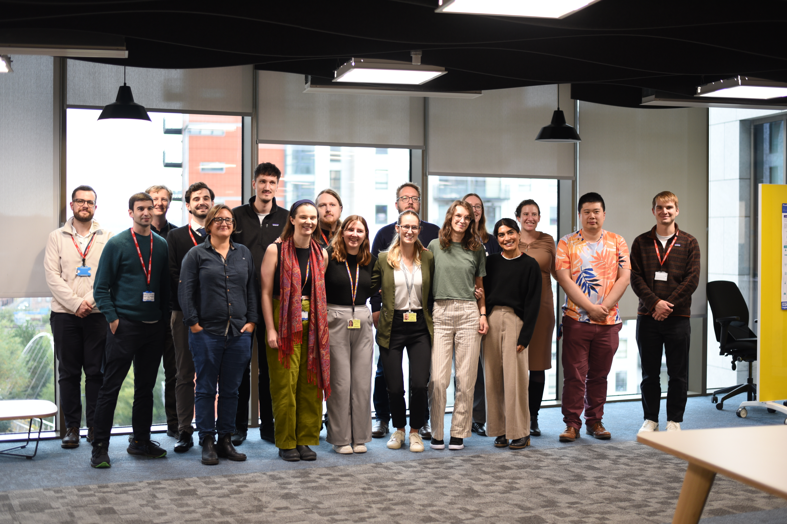
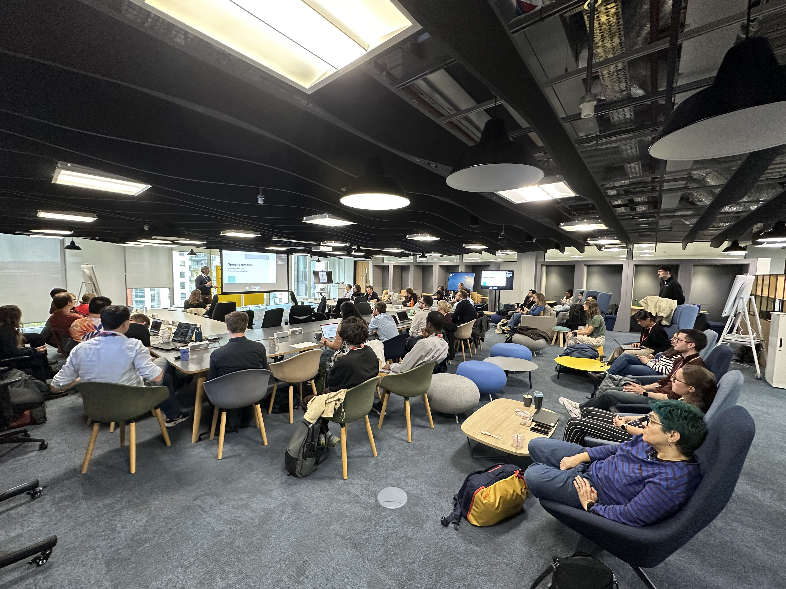

> Do you have a data science problem you have wanted to explore, but never quite had the time, confidence or support to tackle?

<!-- more -->

The Data Science Accelerator gives colleagues the opportunity to develop their data science skills while working on a real problem from their business area. Over 12 weeks, participants receive support from an experienced data science mentor and spend approximately one day a week developing their project.

It is a practical programme built around learning by doing. Participants can develop skills in areas such as Python, machine learning, natural language processing, geospatial analysis, Git, data visualisation and Reproducible Analytical Pipelines, while producing work that can continue to benefit their team after the programme ends.

## Are you “techy” enough to take part? 

Each participant must already have some basic coding experience, but you don't need in depth data science knowledge. Some join with experience in statistical modelling or machine learning, while others are comfortable with Excel and Power BI but are using Python or a data science platform for the first time, others just have a great idea that they want to make a reality.

Helen Bauckham, from NHS England’s Horizon Scanning, Demand Signalling and Innovation Business Development team, described herself as “data-curious” rather than a data scientist before the programme. Working with her mentor, Marcos Fabietti from the North West Anglia NHS Foundation Trust, she created a reproducible Python framework combining several NHS datasets and developed a Power BI dashboard to explore system pressure and hospital burden across integrated care boards.

Her experience was about more than acquiring new technical skills:
> “I learnt that you don’t need to know exactly how to solve something before you start. You need to be willing to break it down, experiment and keep going when your code inevitably throws an error at you.”

She summed up the experience as:
>“Equal parts Python, problem-solving and ‘why on earth isn’t this working?’, but one of the most useful and enjoyable development experiences I’ve had!” 

## Applying data science to real healthcare challenges

The latest cohort demonstrated the breadth of problems that can be explored through the Accelerator.

<figure markdown>
{ width="80%" }
<figcaption>Participants and mentors from the latest Data Science Accelerator cohort.</figcaption>
</figure>

Bashir Abubakar, from the Mental Health Programme at Yorkshire Ambulance Service NHS Trust, developed a clinical natural language processing pipeline to interpret whether concepts in clinical text were present, negated, historical or uncertain. During the programme, he strengthened his skills in Python, few-shot learning, sentence transformers, SetFit, model explainability and responsible AI, with support from his mentor Ben Wallace, from the NHSE Data Science & Applied AI Team.

Emma Silvey, from NHS England’s Elective Analysis team, used direct standardisation to investigate how demographic differences affect variation in Referral to Treatment clock starts across integrated care boards. Supported by Amelia Noonan from the NHSE Data Science & Applied AI Team, she learnt a new analytical method while using the Federated Data Platform, Python transforms, version control and Contour dashboards for the first time. Her work will continue through analysis at different geographical levels and the possible inclusion of further demographic factors. She describes the accelerator as “rewarding and challenging”, the perfect mix for a professional development experience.

## Learning from challenges as well as breakthroughs

Accelerator projects do not always follow their original plan, so don’t worry about having a perfect idea before applying, the mentors are there to help develop great ideas into great products.

Charlotte Scott, from NHS England’s Vaccination and Screening Performance and Delivery Improvement Team, initially planned to investigate very-high-risk breast screening. When issues arised that made that impossible, she adapted her project to explore variation in breast-screening coverage between local authorities.

With support from her mentor, William Poulett from the Data Science & Applied AI team, she compared six regression and machine-learning approaches and used five-fold cross-validation to identify overfitting. The experience strengthened not only her Python and modelling skills, but also her ability to question whether data, methods and results are robust enough to support decisions.

As she explained:
> “The Accelerator gave me the space to explore data differently, restored my enthusiasm for what data can achieve, and left me motivated to keep developing my skills and use them to support better, evidence-led decisions.” 

If that doesn’t convince you that the accelerator could be a great idea for you then I don’t know what will! 

## Sharing achievements and discovering what comes next

The Accelerator’s closing celebration gave mentees the opportunity to present their work to the wider data science community, sharing their project findings and reflecting on what they had achieved during the programme.

<figure markdown>
{ width="80%" }
<figcaption>Participants and guests gathered for a presentation at the Accelerator closing celebration.</figcaption>
</figure>

It was also a chance to look beyond their own projects. As part of the wider event, mentees could hear about data science work taking place across NHS England, the Department of Health and Social Care and NHS Business Services Authority. Quickfire project presentations covered topics such as automating clinical coding, improving data quality and making better use of unstructured text, with time to ask questions and discuss the work. The event brought together the two sides of the Accelerator experience: sharing what you have learnt and discovering new ideas to explore. This experience was an added bonus on the accelerator experience. 

## Could your idea be next?

The Accelerator is designed for people with an interest in data who have a project that could benefit their organisation. To take part, you will need:

* a clear project idea connected to a real business need, with expected benefit to your team or organisation;
* support from your line manager;
* access to the data required;
* approximately one day a week of protected project time; and
* a willingness to experiment, learn and share your work.
* To be able to attend the accelerator wrap-up event on the **12th of May 2027**.

Coding experience is useful but not essential. Candidates with some coding experience will be prioritised if there are more applicants than available mentors.

You do not need to arrive with all the answers. The experiences of previous participants show that curiosity, a useful problem and the willingness to work through uncertainty can be just as important as existing technical knowledge.

If there are more applications than capacity, applicants with coding experience (in any language) and Git experience will be prioritised. Applications will then be sifted according to:

* How viable the project is within the 12 weeks;
* The expected impact of the project on your team, wider organisation, or the public;
* How innovative or advanced the proposed approach is;
* How clear the purpose of the project is and how well-considered your approach is;
* Your personal statement describing your motivation for the programme.

## Applications for the next cohort are now open

To apply, complete the applicant form and send it to DataScience@dhsc.gov.uk by **08 January 2027**. The next programme will run from **01 February 2027** to **30 April 2027**. The scheme is open to anyone working in NHS BSA, NHS England, or DHSC.

Experienced data scientists can also support the programme as mentors. Mentors typically provide around an hour of support each week, with occasional additional time for code review and troubleshooting. If you are interested in mentoring, please also fill out the form and reach out to [datascience@dhsc.gov.uk](mailto:datascience@dhsc.gov.uk). You will be sent a skills matrix to fill out to be best paired with a mentee.
