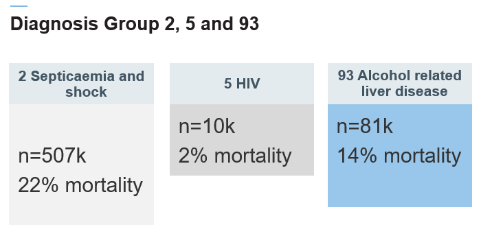
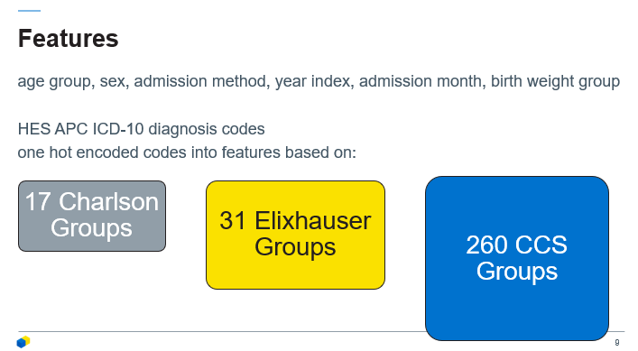
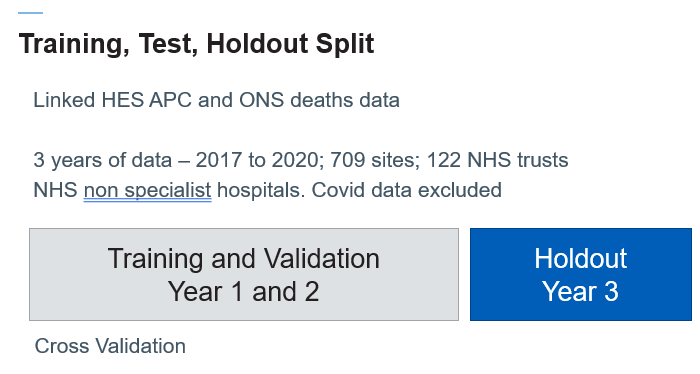
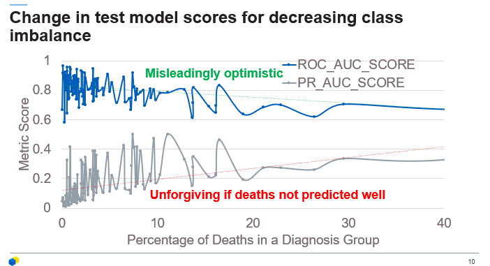
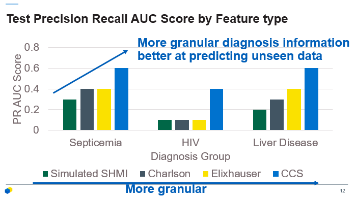
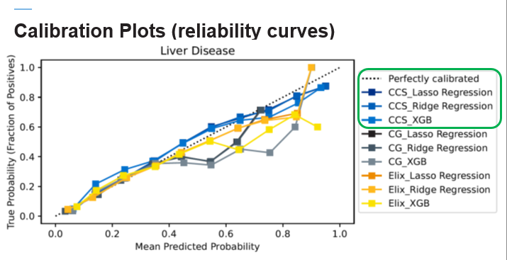
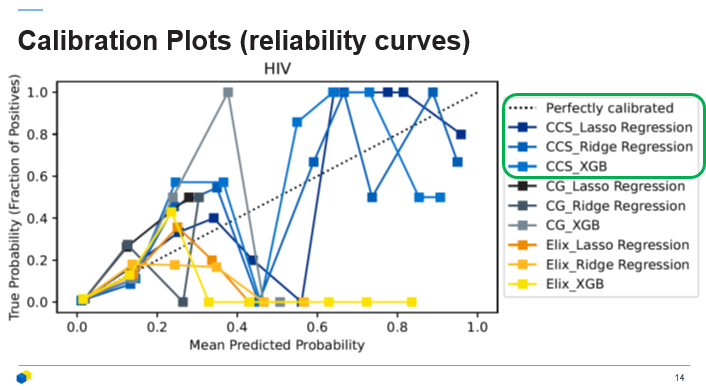
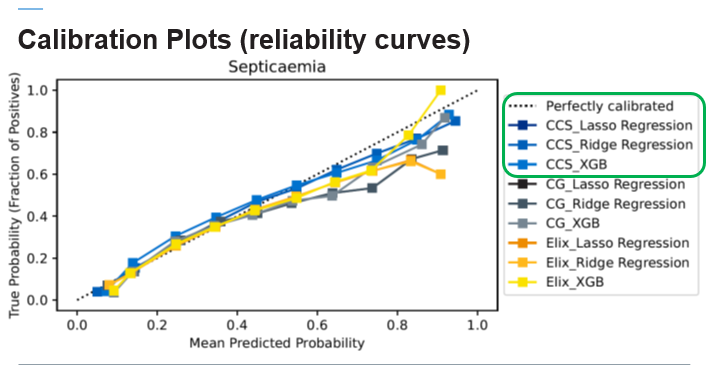

*This project was completed by Adam Hollings, Principal Data Scientist, in the Data Science & Applied AI Team, as part of the Data Science MRes at the University of Leeds*

## Objectives 
SHMI does not score well when modelling some diagnosis groups despite using ROC AUC score which is forgiving when class imbalance is high. This study aimed to explore the effect on scores of replacing the Charlson index score with up to 260 one hot encoded diagnosis features as well as testing lasso regression and XGboost instead of the current SHMI ridge regression models. It also used PR AUC score instead of ROC AUC score.
## Design

Out of the 142 SHMI diagnosis groups, this study focused on 3. Results for all other groups can be found in the write up appendix (contact [adam.hollings1@nhs.net](mailto:adam.hollings1@nhs.net)). Diagnosis groups 2, 5 and 93 were chosen as they varied in level of mortality and the number of episodes recorded. Low mortality means a higher class imbalance.

The features used in the model were identical to those used in the published SHMI and used the same source data, with only a difference in how diagnoses was encoded. Published SHMI took diagnosis and encoded this into a very narrow 1-3 value of wellness based on a modified Charlson Index. Our approach was instead to one hot encode features based upon various groupings; 17 Charlson Groups, 31 Elixhauser Groups and 260 CCS Groups based upon the Charlson Index, Elixhauser Index and CCS groups respectively.

## Setting 

1st April 2017 and 30th April 2020 England, United Kingdom.
## Participants 
709 sites across 122 NHS trusts across England were used for this study
## Results

The study used 3 years of data from 207 to 2020.
The image above shows that across all diagnosis groups, not just 2, 5 and 93, ROC AUC was a much more forgiving metric than PR AUC and gave higher scores to groups with the highest class imbalance. This was due to deaths not be accurate predicted but the majority of cases being living patients. PR AUC gave a much more severe but realistic representation of model performance in predicting chance of death within 30 days of discharge. 

The more granular approaches had better performance: Septicemia and Shock (SHMI 0.3, CCS groups 0.6, Elixhauser groups 0.4, Charlson groups 0.4), HIV (SHMI 0.1, CCS groups 0.4, Elixhauser groups 0.1, Charlson groups 0.1), Alcohol Related Liver Disease  (SHMI 0.2, CCS groups 0.6, Elixhauser groups 0.4, Charlson groups 0.3).
PR AUC scores were lower overall compared to ROC AUC scores. The results showed the greater the granularity of diagnosis encoding the higher the PR AUC score, with the most granular having approximately double to eight times the score of the SHMI model for the same group for the groups studied.

For group 2 the models all look quite well calibrated as shown by being close to the diagonal dotted line (the simulated SHMI isn’t on this figure). The CCS group models tend to more closely follow the ideal calibration line. There doesn’t appear to be much difference in calibration between logistic regressions and Xgboost.

HIV had a smaller sample size and lower model scores, but the CCS model calibrations were still better than the other groupings

And again here CCS group models more closely follow the ideal calibration line again.

## Conclusions 
SHMI could be significantly improved by considering more granular diagnosis encoding methods. PR AUC should be used as a scoring method instead of ROC AUC.

## Strengths and Limitations of this study
- Used PR AUC unlike the current SHMI implementation and so better represents how well both deaths and survival are predicted by the models
- Large sample size
- This study only covers 3 diagnosis groupings, although the supplementary information covers 139 other diagnosis groupings.
- Does not include ethnicity or deprivation as features
- Diagnosis representation categories were given equal weighting at feature creation stage

## Code
Find the code on github [here](https://github.com/AdamHollings/MRes-SHMI-Improvement-Project)

## Contact
[adam.hollings1@nhs.net](mailto:adam.hollings1@nhs.net)

#
