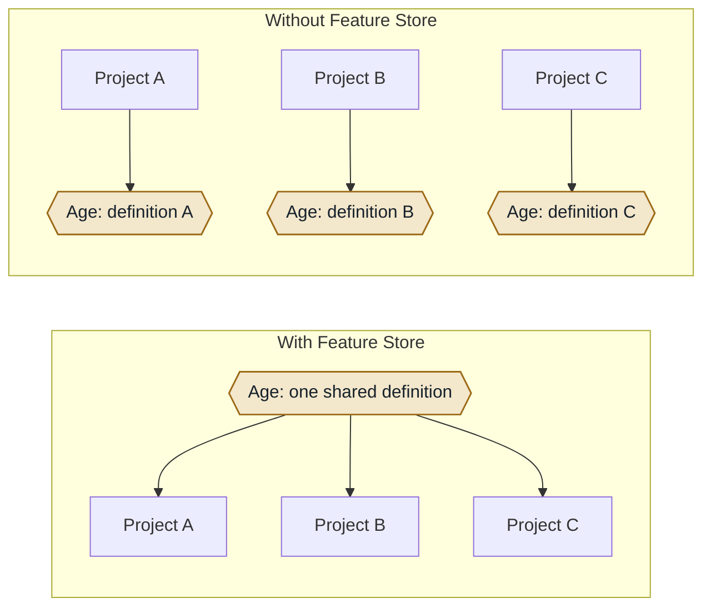
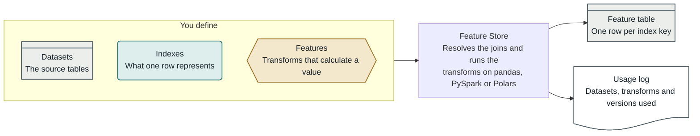
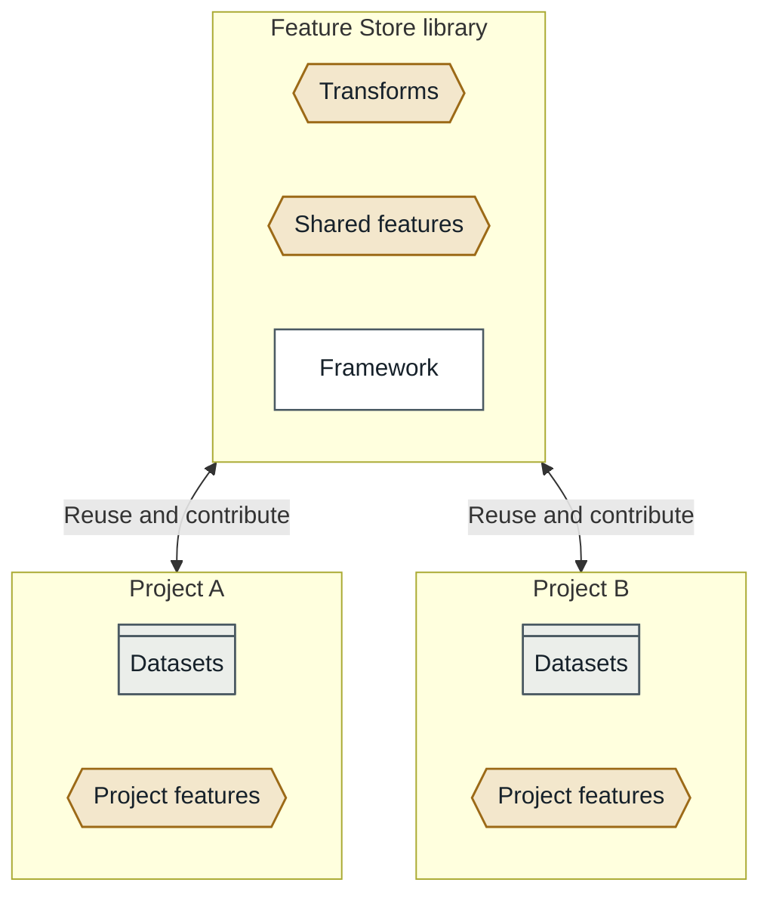

!!! warning

    This project is in development, so what follows may change.

## About Feature Store

Feature Store is a team-wide collection of reusable feature engineering code that helps us discover, use, and share features across projects. It standardises how we create and transform features, which cuts down on duplicate work and makes our outputs more consistent. It also gives the team a common language for handling features.

It is built by the Data Science team, for the Data Science team.

## Problem

Many of our projects need the same kinds of features: counts of past events, time since an event, categories grouped into bands, values summarised per person. Each project tends to write these again from scratch. This means:

- the same work is done many times over
- two projects can define what looks like the same feature in slightly different ways
- it is hard to explain later exactly how a feature in a finished model was built
- moving a project to a different data platform or tool often means rewriting its features

Feature Store gives each feature one shared definition that every project can use.

## Intended Benefit

- **Less duplicate work.** A feature written once can be reused by other projects.
- **Consistent outputs.** Shared definitions mean shared meaning across projects.
- **Explainable results.** Every dataset it builds records the recipe behind it, so a result can be traced back to how it was made.
- **Portable code.** One feature definition runs on pandas, PySpark or Polars, so features can move between platforms with less rework.
- **A route from notebook to production.** Features explored in a notebook can be exported as packaged code.

For one table, one analysis and no reuse, writing the code directly will be quicker. Feature Store pays off when features are reused across projects, or when a result has to be explained later.

## How it works

Feature Store is a Python package that can be installed on any standard Python platform. It is built around four ideas:

- **Dataset:** a table you bring in, together with the identifiers it carries.
- **Index:** what one row means, and the columns that identify it ("one row of this is one what?").
- **Feature:** one value, at exactly one index, worked out by a list of steps.
- **Transform:** one step of work, where a table goes in and a table comes out.

Because it knows how datasets, indexes and features relate, Feature Store works out the joins itself. It also refuses requests it cannot serve safely. For example, it rejects a join that would turn one row into many, and asks for an aggregation instead.

There are two ways of working:

- **Workbench:** for exploring and prototyping in a notebook. You bring in data, look at it, add a feature, look at that, and keep what works.
- **Declared:** for design-led work. Datasets, indexes and features are written as Python classes and kept in a package, and a dataset is requested from the store.

The workbench is a friendlier layer over the declared approach, and work in the workbench can be exported to declared, packaged code.

Other parts include:

- cohorts, to control which records features are built on
- feature dependencies, so one feature can be used as the input to another
- a usage log, which records how each dataset was built

Projects install the shared library and keep their own data sources and project-specific features. Anything generally useful can be contributed back for other projects to reuse.

## Data

Feature Store is a general-purpose library and does not contain any data. Its documentation and tests use fabricated data only. Each project uses it on its own data, within that project's existing data access and governance arrangements.

## Key Exploitable Results

- **Reusable feature engineering library:** a Python package for building features on pandas, PySpark or Polars.
- **A shared approach:** a common way to define, explain and share features across the team's projects.

## Teams

- NHS England Data Science team

## Project Status

Feature Store is a work in progress. Version 0.2.0 has been released, and the library is being piloted on one of the team's projects with feedback from its users. Next steps include sharing published, versioned features between projects.

[comment]: <> (The below header stops the title from being rendered (as mkdocs adds it to the page from the "title" attribute) - this way we can add it in the main.html, along with the summary.)
#
